# HydrogenTrack 🌿
### Hydrogen Production, Storage & Distribution Monitoring Platform

HydrogenTrack is a web-based dashboard for monitoring hydrogen production, storage facilities, shipments, deliveries, operational alerts, and analytics in one place. It brings operational information together so administrators and teams can review system status, track hydrogen movement, and identify issues that need attention.

> **Project repository:** [shanmukhapriyab/hydrogentrackernew](https://github.com/shanmukhapriyab/hydrogentrackernew)

## 📸 Screenshots

### Admin dashboard
A high-level view of system activity, users, plants, critical alerts, and summary charts.

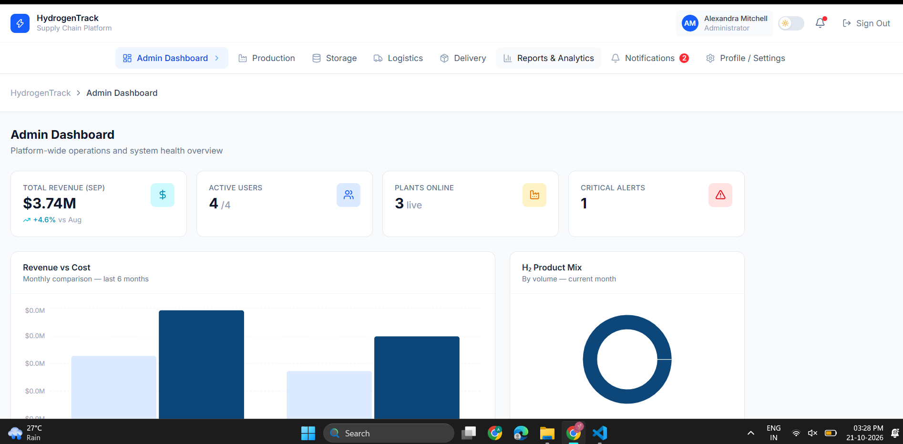

### Dashboard overview
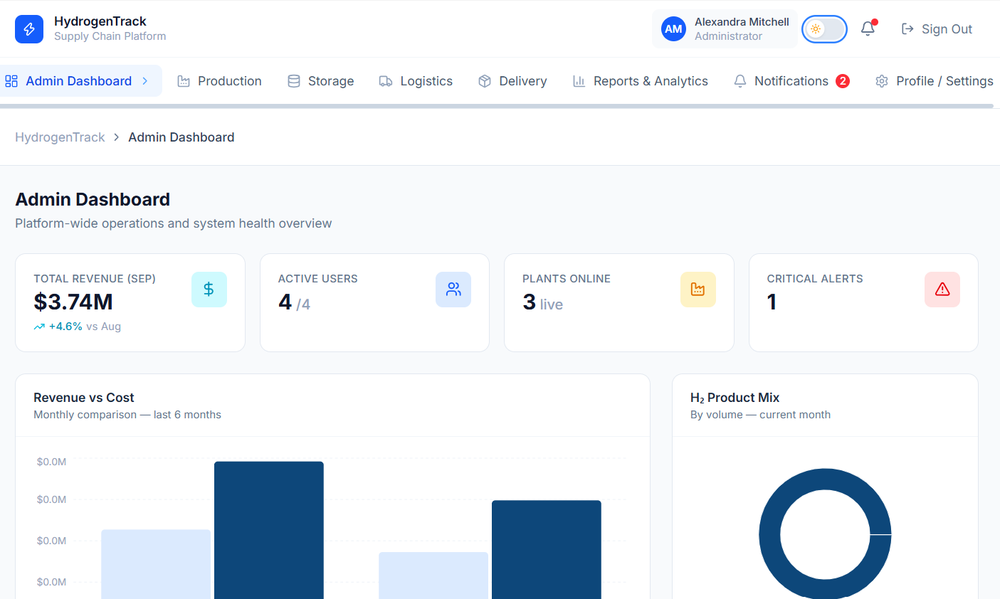

### Production management
View production facilities, output, utilization, and operational details.

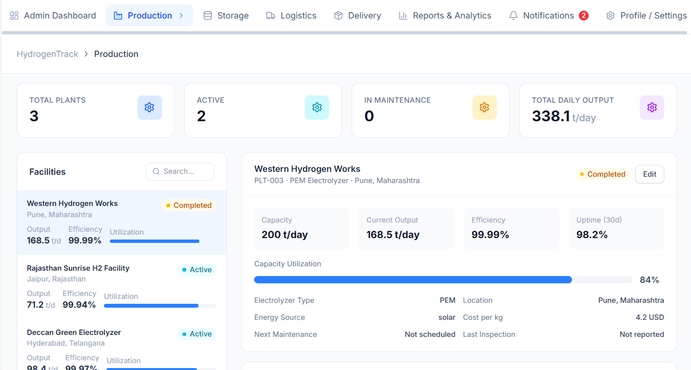

### Production analytics
Visualize production output and operational readings such as temperature, pressure, and hydrogen purity.

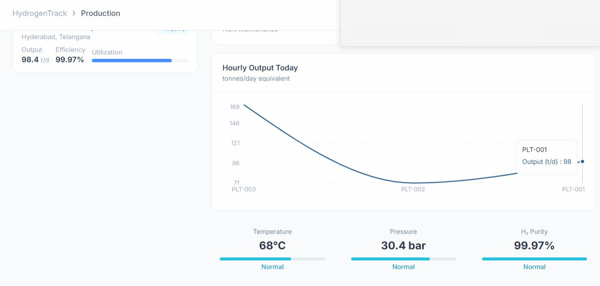

### Storage management — Add Tank
Create a storage-tank record by entering facility, tank ID, capacity, current level, pressure, temperature, safety threshold, and location coordinates.

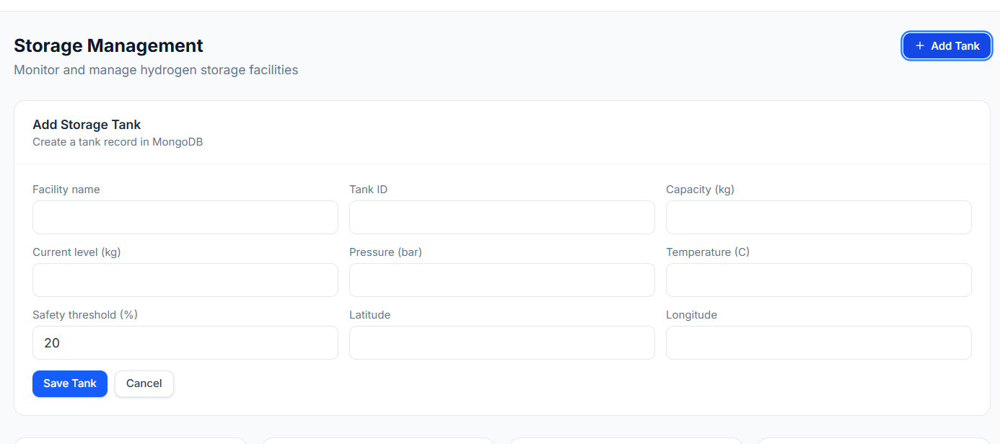

### Storage overview
Review inventory, tank capacity, fill levels, and critical tank conditions.

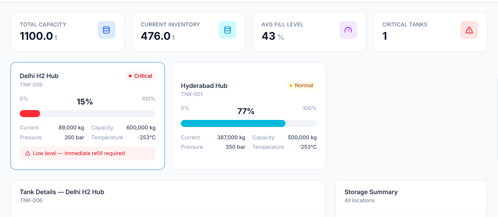

### Tank details and alerts
Inspect an individual tank's readings and status, review history, and access available tank actions.

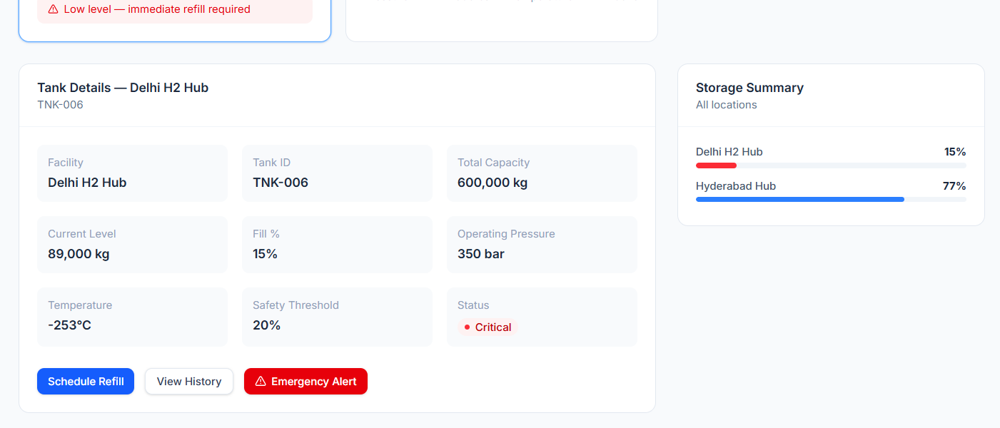

### Shipment tracking
Monitor shipments, routes, customers, quantities, progress, ETA, and delivery status.

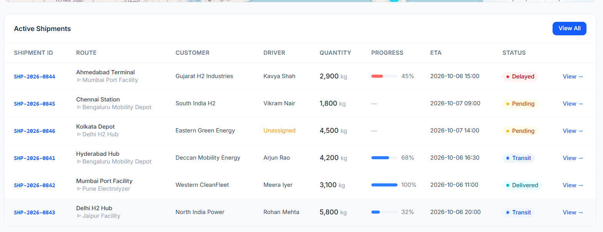

### Delivery management
Review scheduled deliveries, destinations, quantities, and driver or delivery status.

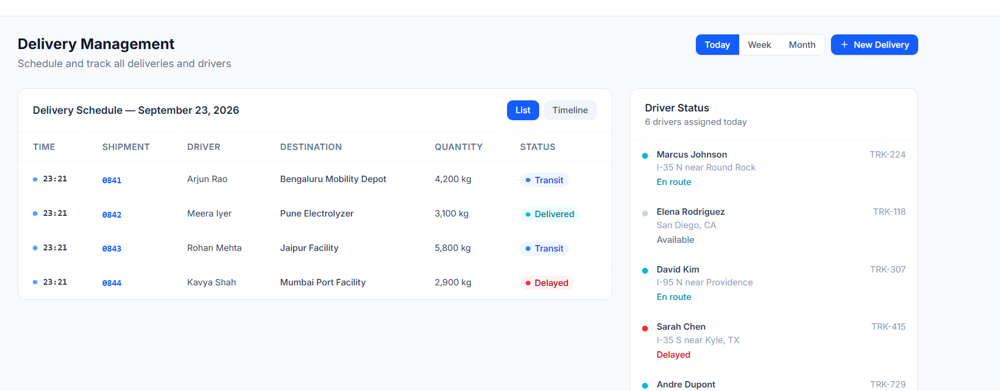

### Reports dashboard
Review summary metrics and visual reports for production, revenue, logistics, and operations.

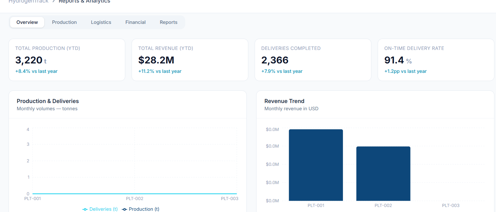

### Analytics and downloadable reports
Explore analytical charts and available reports.

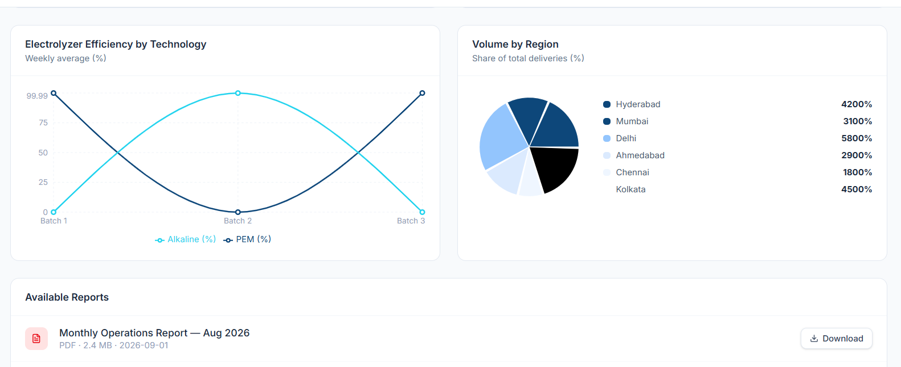

### Notifications
Review unread, critical, and operational notifications, including low tank levels and delayed shipments.

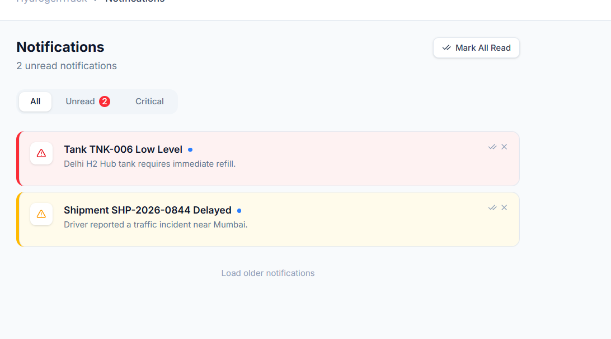

## ✨ Features

- **Role-oriented dashboard:** Centralized operational overview and system metrics.
- **Production monitoring:** Track production facilities, output, utilization, and process readings.
- **Storage and tank management:** Add tank records, monitor inventory and fill levels, and highlight low-level or critical tanks.
- **Shipment tracking:** Follow shipment quantity, route, progress, ETA, and status.
- **Delivery management:** View delivery schedules, destinations, quantities, and delivery updates.
- **Reports and analytics:** Present operational data through charts, summaries, and report downloads where enabled.
- **Notifications and alerts:** Surface issues such as low tank levels and delayed shipments.
- **Map/location support:** Display location-related infrastructure or logistics information where configured.
- **Persistent data:** Store application records in MongoDB through the backend API.

## 🧰 Technology Stack

| Layer | Technology | Purpose |
|---|---|---|
| Frontend | React, Vite | User interface and page navigation |
| Backend | Node.js, Express.js | REST API and application logic |
| Database | MongoDB | Store users and operational records |
| Real-time updates | Socket.IO (where configured) | Push live events/notifications to connected clients |
| Charts | Frontend charting components | Display production and operational analytics |
| Mapping | Map component/provider configured in the project | Visualize location-related information |

*The exact libraries and optional integrations depend on the current source-code configuration.*

## 🗂️ Main Modules

| Module | What it does |
|---|---|
| Admin Dashboard | Shows overall system KPIs, activity, and alerts. |
| Production | Displays production facilities, output, and process measurements. |
| Storage | Manages tanks and monitors capacity, inventory, and safety thresholds. |
| Logistics / Shipments | Tracks hydrogen shipments and their progress. |
| Delivery | Organizes delivery schedules and status. |
| Reports & Analytics | Summarizes operational data using charts and reports. |
| Notifications | Shows important events and issues requiring attention. |
| Profile / Settings | Provides account and application settings. |

## 🔄 How It Works

1. A user signs in and opens the dashboard.
2. The frontend requests application data from the Express backend.
3. The backend validates and processes requests, then reads or writes records in MongoDB.
4. The UI presents the returned information in tables, status indicators, charts, and location views.
5. When real-time events are configured, Socket.IO can deliver updates to connected clients.
6. Notification and alert views help users identify operational issues, such as a low tank level or delayed shipment.

## 🚀 Getting Started

### Prerequisites

- Node.js and npm
- MongoDB Community Server running locally, or a MongoDB connection URI
- Git

### 1. Clone the repository

```bash
git clone https://github.com/shanmukhapriyab/hydrogentrackernew.git
cd hydrogentrackernew
```

### 2. Install dependencies

This project has a frontend and backend. Open a terminal in each directory that contains its own `package.json` and run:

```bash
npm install
```

If the repository uses separate `client`/`server` or `frontend`/`backend` folders, run the command from each of those folders.

### 3. Configure environment variables

Create the required `.env` file(s) based on the variable names used by the source code. Set your MongoDB connection URI and any authentication, map-provider, or API secrets required by your configuration.

**Do not commit real passwords, JWT secrets, database credentials, or API keys.** Keep `.env` files out of Git and provide a safe `.env.example` for collaborators.

### 4. Start the backend

From the backend directory, use the start script defined in its `package.json`, for example:

```bash
npm run dev
```

If no `dev` script exists, use the script listed under `scripts` in that directory's `package.json`.

### 5. Start the frontend

From the frontend directory, run the Vite script defined in its `package.json`, commonly:

```bash
npm run dev
```

Open the local URL printed in the terminal (often `http://localhost:5173`). The backend in this project has previously been run on `http://localhost:5000`; use the ports configured in your local environment.

## 🧪 Example Workflow: Adding a Storage Tank

1. Open **Storage**.
2. Select **Add Tank**.
3. Enter the tank's facility name, tank ID, capacity, current level, pressure, temperature, safety threshold, latitude, and longitude as requested by the form.
4. Select **Save Tank**.
5. The frontend sends the tank details to the backend API.
6. The backend stores the record in MongoDB.
7. After a successful save, the tank should appear in the storage list/overview and its capacity and inventory should contribute to relevant storage summaries. Tank details and critical notifications may update according to the application's configured logic.

If the saved tank does not appear, check the browser console, backend terminal, API response, and MongoDB collection to confirm that the request succeeded and the UI refreshes its data.

## 🗺️ Maps and Notifications

- **Maps:** Location markers or routes are based on the coordinates and location data available to the application and on the configured map provider. A map is only truly live when it receives updated data; a map displaying stored coordinates alone is not a live GPS feed.
- **Notifications:** The application can surface operational alerts such as low tank levels and delayed shipments. Real-time delivery depends on the backend event logic and Socket.IO connection being configured; otherwise, alerts may update when the page fetches or refreshes data.

## 🔐 Security Notes

- Keep secrets in environment variables.
- Never commit real user credentials or production database data.
- Validate and authorize API requests on the backend.
- Restrict CORS to trusted frontend origins in deployed environments.
- Use HTTPS and secure deployment settings for production.

## 🛠️ Troubleshooting

- **Frontend cannot reach API:** Confirm the backend is running and the frontend API base URL points to the correct host and port.
- **MongoDB connection error:** Check that MongoDB is running and the URI/database name are correct.
- **Tank saved but not visible:** Check the API response and database record, then verify the storage page refreshes or refetches data.
- **No real-time notifications:** Confirm Socket.IO client/server URLs, connection status, and the backend event emission logic.
- **Map is blank:** Verify the map provider configuration, valid coordinates, and any required API key or allowed-domain settings.

## 👩‍💻 Author

**Shanmukha Priya**  
GitHub: [@shanmukhapriyab](https://github.com/shanmukhapriyab)

---

If you use or extend this project, please update this README whenever the application setup, environment variables, or modules change.
